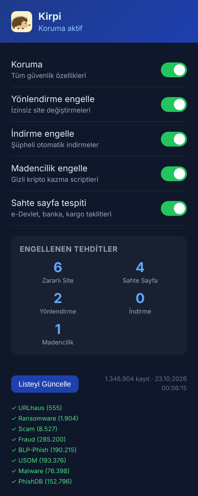
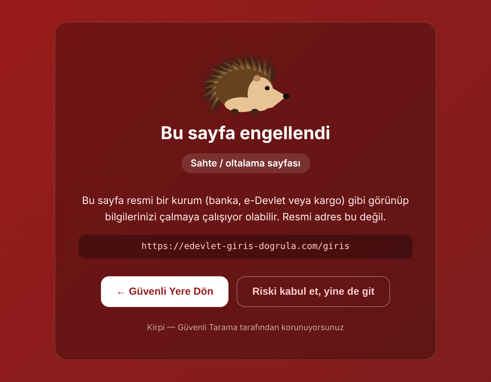

<p align="center"></p>

# Kirpi — Güvenli Tarama

Türkiye'deki kullanıcılar için yazılmış, açık kaynaklı bir **Chrome / Edge güvenlik eklentisi**. Zararlı sitelere girişi, izinsiz yönlendirmeleri, gizli dosya indirmelerini, tarayıcıda kripto madenciliğini ve **sahte e-Devlet, banka ve kargo sayfalarını** engeller.

Kirpi'yi benzerlerinden ayıran şey yerel veri: T.C. Siber Güvenlik Başkanlığı'nın (USOM) resmi zararlı adres listesini ve Türkiye'ye özgü dolandırıcılık kalıplarını kullanır.

<table>
  <tr>
    <td align="center" width="38%"></td>
    <td align="center"></td>
  </tr>
  <tr>
    <td align="center"><sub>Panel</sub></td>
    <td align="center"><sub>Sahte sayfa uyarısı</sub></td>
  </tr>
</table>

## Özellikler

| Koruma | Ne yapar |
|---|---|
| **Zararlı site engelleme** | Gidilen adresi ~1,3 milyon zararlı domainlik bir listede arar. Eşleşirse sayfa yerine Türkçe bir uyarı ekranı gösterir. Alt alan adlarını da kapsar (`x.kotu.com` → `kotu.com`). |
| **Sahte sayfa tespiti** | e-Devlet, Gelir İdaresi, SGK, 25 banka ve ödeme hizmeti, kargo, telekom ve e-ticaret firmaları dahil 51 markanın taklidini yakalar: kimlik, şifre ya da kart bilgisi isteyip resmi adreste olmayan sayfalar. Marka adı başlıkta, logoda ve giriş formunun çevresinde aranır, altbilgideki ya da "... ile giriş yap" düğmelerindeki marka adları yanlış alarma yol açmaz. Listede olmayan yeni sitelere karşı da çalışır. |
| **Dolandırıcılık kalıpları** | Marka taklidi olmasa bile "vergi iadeniz", "HGS ihlali", "kargonuz teslim edilemedi", "gümrük ücreti", "çekilişi kazandınız" gibi Türkiye'de sık görülen senaryolar kart ya da şifre alanıyla birlikte geçerse uyarır. |
| **Yönlendirme koruması** | Sayfanın sizi izinsizce **zararlı** bir adrese göndermesini (JavaScript veya `meta refresh` ile) durdurur. Güvenilir ve bilinmeyen hedeflere dokunmaz. |
| **İndirme koruması** | Zararlı listesindeki sitelerden gelen indirmeleri iptal eder. Diğer sitelerden gelen `.exe`, `.msi`, `.apk` gibi çalıştırılabilir dosyaları durdurur ve **"İndirmeye devam et / İptal et"** diye sorar. PDF, ZIP gibi normal dosyalara dokunmaz. |
| **Madencilik engelleme** | Bilinen kripto madenciliği scriptlerini sayfadan kaldırır. |
| **Gizli çerçeve temizliği** | Zararlı listesindeki adreslere ait görünmez çerçeveleri (iframe) kaldırır. Google girişi, captcha veya ödeme gibi meşru gizli çerçevelere dokunmaz. |
| **Güvenilir siteler** | Uyarı ekranındaki **"Yine de devam et"** siteyi tarayıcı kapanana kadar açar. **"Bu siteye her zaman güven"** seçeneği siteyi kalıcı beyaz listeye ekler. Önceden bir şey ayarlamanız gerekmez: resmi kurumlar ve bilinen sitelerin resmi adresleri zaten güvenilir sayılır. Liste yalnızca yanlış alarmlar için bir çıkış kapısıdır; eklenen siteler panelde görünür ve oradan çıkarılabilir. |
| **Açılır pencere engelleme** | Kullanıcı tıklamadan açılan pencereleri (popunder) engeller. Tıklamadan sonraki 5 saniye içinde açılan giriş ve ödeme pencerelerine dokunmaz. |

Resmi Türkiye uzantıları (`gov.tr`, `edu.tr`, `k12.tr`, `bel.tr` vb.) ve bilinen büyük siteler, yanlış alarm olmaması için sahte sayfa kontrolünün dışında tutulur.

## Kurulum

Eklenti henüz Chrome Web Mağazası'nda yok. Geliştirici modunda kurulur:

1. [**Releases**](https://github.com/metehandghn/kirpi-guvenli-tarama/releases/latest) sayfasından en son **`kirpi-v….zip`** dosyasını indirin ve bir klasöre çıkarın.
2. Chrome'da adres çubuğuna `chrome://extensions` yazın (Edge'de `edge://extensions`).
3. Sağ üstten **Geliştirici modu**'nu açın.
4. **Paketlenmemiş öğe yükle**'ye tıklayın ve ZIP'i çıkardığınız klasörü seçin (içinde `manifest.json` olan klasör).

> Kaynak koddan kurmak isterseniz: **Code → Download ZIP** ile repoyu indirip 4. adımda repo içindeki **`extension`** klasörünü seçin.
5. Araç çubuğunda kirpi simgesi görünür. İlk kurulumda zararlı listeler arka planda indirilir. Bu birkaç dakika sürer, bu sırada tarayıcıyı kullanmaya devam edebilirsiniz.

> Klasörü kurulumdan sonra silmeyin veya taşımayın. Eklenti doğrudan o klasörden çalışır.

## Nasıl çalışır

```
extension/
├── background.js   Arka plan servisi: listeleri indirir, adresleri kontrol eder, indirmeleri denetler
├── content.js      Her sayfada çalışır: sahte sayfa, madencilik, gizli çerçeve, yönlendirme
├── hook.js         Sayfanın kendi ortamında çalışır (world: MAIN): window.open / location izleme
├── warning.html    Engellenen sayfalar için Türkçe uyarı ekranı
└── popup.html      Açma/kapama anahtarları, istatistikler, kaynak durumları
```

**Liste depolama.** 1,3 milyon domain belleğe yüklenmez. Domainler bir hash ile 1024 kovaya bölünür ve her kova IndexedDB'de tek kayıt olarak saklanır. Bir adres kontrol edilirken yalnızca ilgili küçük kova okunur. Bu sayede sayfa açılışlarında gecikme veya donma olmaz.

**Güncelleme.** Listeler 6 saatte bir kendiliğinden güncellenir, istenirse panelden elle de güncellenebilir. Manifest V3'te Chrome arka plan servisini uzun işlerin ortasında kapatabildiği için güncelleme küçük adımlara bölünür ve her adımdan sonra kaldığı yer kaydedilir. Servis kapanırsa dakikada bir çalışan bir alarm işi kaldığı yerden sürdürür. Aynı adım üst üste 3 kez başarısız olursa atlanır. Güncelleme sırasında liste boşalmaz, yeni kayıtlar mevcut listeye eklenir. İşlemci tek seferde uzun süre meşgul edilmez.

**Öncelik.** Toplam kayıt sayısı 1,5 milyonla sınırlıdır. Küçük ve özenle hazırlanmış listeler ile USOM tam olarak alınır, kalan yer büyük genel listelere paylaştırılır.

## Veri kaynakları

| Kaynak | İçerik | Lisans / şartlar |
|---|---|---|
| [USOM — T.C. Siber Güvenlik Başkanlığı](https://siberguvenlik.gov.tr/api/) | Türkiye'ye yönelik zararlı domain ve adresler (en güncel ~200 bin) | Güvenlik sistemlerine entegrasyon için yayınlanan resmi API |
| [urlhaus-filter](https://gitlab.com/malware-filter/urlhaus-filter) | abuse.ch URLhaus zararlı yazılım siteleri | MIT (filtre). Veri [abuse.ch şartlarına](https://abuse.ch/) tabidir |
| [The Block List Project](https://github.com/blocklistproject/Lists) | Zararlı yazılım, fidye yazılımı, dolandırıcılık, sahtekârlık ve oltalama listeleri | Unlicense |
| [Phishing.Database](https://github.com/mitchellkrogza/Phishing.Database) | Aktif oltalama domainleri | MIT |

Kirpi bu listeleri her kullanıcının tarayıcısına doğrudan kaynaklarından indirir, verileri yeniden dağıtmaz. Ticari kullanım düşünüyorsanız her kaynağın şartlarını ayrıca kontrol edin. OpenPhish ücretsiz beslemesi, şartları verinin üçüncü kişilere sunulmasını izinsiz yasakladığı için kullanılmamaktadır.

## Gizlilik

Kirpi ziyaret ettiğiniz adresleri **hiçbir yere göndermez.** Tüm kontroller bilgisayarınızda, yerel listeye bakılarak yapılır. İnternete yalnızca yukarıdaki kaynaklardan listeleri indirmek için bağlanır.

## Sınırlar

- **Antivirüs değildir.** Tarayıcının kendi güvenlik açıklarını kullanan saldırıları durduramaz. Tarayıcınızı ve işletim sisteminizi güncel tutun, bir antivirüs kullanın.
- Hiçbir listede bulunmayan ve bilinen bir markayı da taklit etmeyen yepyeni zararlı siteleri her zaman yakalayamaz.
- Madencilik tespiti bilinen imzalara dayanır, gizlenmiş (obfuscated) scriptleri kaçırabilir.
- Sahte sayfa tespiti 51 markayı kapsar (`content.js` içindeki `BRANDS` listesi). Dolandırıcılık kalıpları da 32 belirli ifadeye dayanır (`SCAM_PHRASES`).

## Deneme

`demo/` klasöründeki sayfalar her korumayı zararsız biçimde tetikler. Gerçek bir zararlı siteye gitmenize gerek yoktur.

1. `chrome://extensions` → Kirpi → **Ayrıntılar** → **Dosya URL'lerine erişime izin ver** seçeneğini açın.
2. `demo/index.html` dosyasını Chrome'da açın ve bağlantıları tek tek deneyin.

Engelleme testi için `kirpi-test.example` adresi kullanılır. `.example` uzantısı gerçek bir siteye gitmez.

## Geliştirme ve testler

Testler gerçek tarayıcı yerine Node.js üzerinde, taklit edilmiş Chrome API'leri ile çalışır (`fake-indexeddb`, `jsdom`).

```bash
npm install
npm test
```

> **Not:** Madenci imzaları ve madenci domainleri kaynak kodda **ters çevrilmiş** olarak saklanır ve çalışırken düzeltilir. Bunun sebebi, antivirüs programlarının bu kelimeleri düz metin olarak gördüğünde eklentinin kendisini madenci sanmasıdır. Demo ve test dosyaları da aynı sebeple imzaları parçalardan oluşturur.

> **Not:** Proje önceden "Kalkan" adını taşıyordu. Mevcut kullanıcıların listesi ve istatistikleri silinmesin diye tarayıcıda saklanan verilerin iç anahtar adları (`kalkanCount`, `kalkanDB` vb.) değiştirilmedi.

Testlerin kapsadığı başlıca durumlar:
- Güncelleme ortasında arka plan servisinin kapatılması ve alarmla kaldığı yerden devam edilmesi
- Sürekli hata veren bir kaynağın 3 denemeden sonra atlanması
- Eklenti yenilendiğinde liste tazeyse gereksiz indirme yapılmaması
- Alt alan adı eşleşmesi, güncelleme sırasında listenin boşalmaması
- Sahte sitelerin yakalanması; gerçek Garanti, sahibinden, e-Devlet ve ÖSYM sayfalarında yanlış alarm olmaması
- YouTube ve Google'ın gizli çerçevelerine dokunulmaması
- Ters çevrilmiş madenci imzalarının doğru çözülmesi ve ağ kuralının kurulması
- Bilerek indirilen kurulum dosyalarının iptal edilmeyip kullanıcıya sorulması, zararlı siteden gelen indirmenin iptal edilmesi
- Chrome'un indirme geçmişindeki eski kayıtlara dokunulmaması
- "Yine de devam et" sonrası sitenin tekrar engellenmemesi; geçici ve kalıcı izin, beyaz listeden çıkarma
- Büyük harfli Türkçe marka adlarının ("İŞ BANKASI") yakalanması, yeni markaların sahte ve gerçek siteleri
- Altbilgideki ve sosyal giriş düğmelerindeki marka adlarının yanlış alarm vermemesi
- Marka olmadan dolandırıcılık kalıplarının yakalanması, normal ödeme sayfalarının etkilenmemesi

## Katkı

Hata bildirimleri ve öneriler için Issue açabilirsiniz. Yanlış alarm bildirirken sitenin adresini ve gördüğünüz uyarıyı yazmanız yeterli. Yeni marka eklemek için `extension/content.js` içindeki `BRANDS` listesine resmi domainleriyle birlikte ekleme yapabilirsiniz. Yeni bir dolandırıcılık ifadesi gördüyseniz `SCAM_PHRASES` listesine ekleyin; ifadeleri Türkçe karakter kullanmadan, küçük harfle yazın (ör. `vergi iadeniz`).

## Lisans

[MIT](LICENSE) © 2026 Metehan Dağhan
